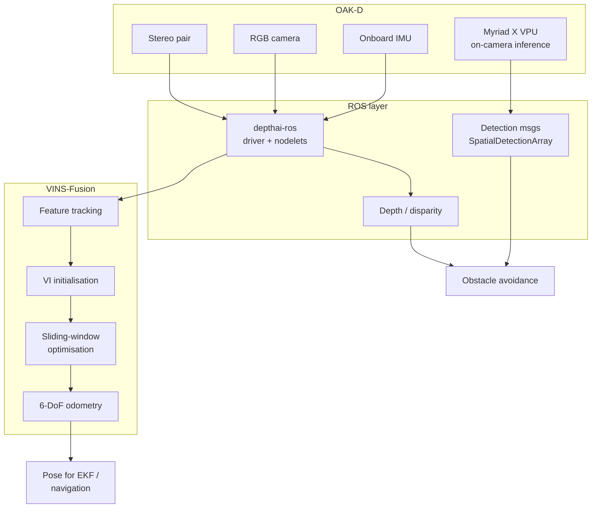

# OAK-D Perception + VINS-Fusion — ROS Integration

Integration project: bringing up a **Luxonis OAK-D** depth camera under ROS
alongside **VINS-Fusion** visual-inertial odometry, as a perception front-end
for GPS-denied flight.

---

> **Scope note.** This repository documents a **systems integration**, not new
> algorithms. `depthai-ros` and `VINS-Fusion` are third-party packages —
> referenced here, not redistributed. The contribution is the bring-up,
> configuration and calibration of the two together.

## Why this pairing

The OAK-D carries stereo depth **and** an onboard VPU that runs neural
inference on-camera, so detection does not consume host compute. VINS-Fusion
provides tightly-coupled visual-inertial odometry. Together they give a
companion computer both **obstacle perception** and **ego-motion estimation**
from one sensor head.

## System architecture

## Stack

| component | role |
|---|---|
| [`depthai-ros`](https://github.com/luxonis/depthai-ros) | OAK-D ROS driver — depth, RGB, spatial detections, IMU |
| [`depthai-python`](https://github.com/luxonis/depthai-python) | Python API / DepthAI core |
| [`VINS-Fusion`](https://github.com/HKUST-Aerial-Robotics/VINS-Fusion) | HKUST visual-inertial odometry |

The original workspace archive is **not** committed — it contained only these
upstream sources plus `build/` and `devel/` artifacts. Reproduce it by cloning
the three repositories above into a catkin workspace.

## Practical notes

**Extrinsic calibration is the hard part.** VINS-Fusion needs accurate
camera-to-IMU extrinsics and time offset. The OAK-D's onboard IMU is rigidly
mounted relative to the stereo pair, which helps, but the transform still has
to be measured properly — a poor calibration shows up as drift that looks like
an algorithm problem but isn't.

**Initialisation needs motion.** VINS cannot bootstrap scale from a stationary
start. Expect a short excitation manoeuvre before odometry is usable.

**On-camera inference is the real advantage.** Running detection on the Myriad
X leaves the host free — the significant difference versus a plain stereo
camera when the host is a flight companion computer.

**USB bandwidth is a real constraint.** Streaming full-rate stereo plus RGB
plus detections saturates USB easily. Decide what actually needs to leave the
camera.
